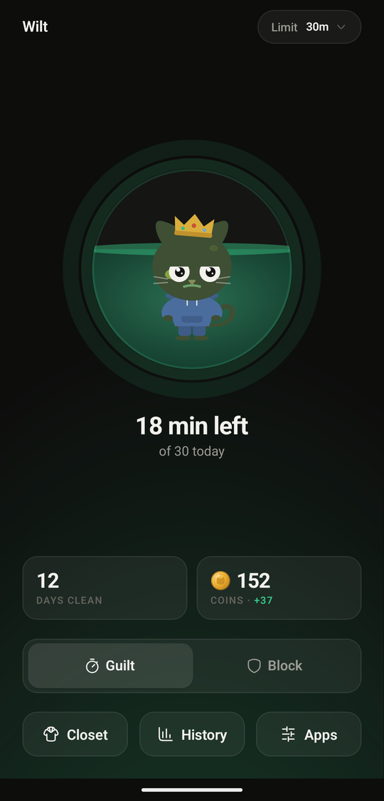
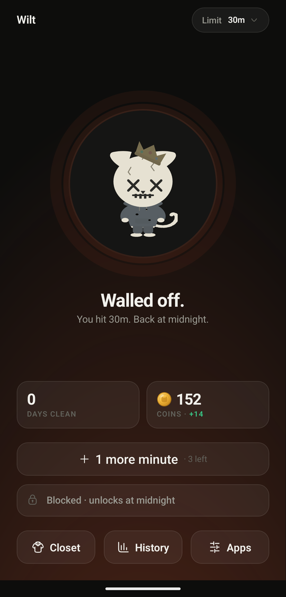
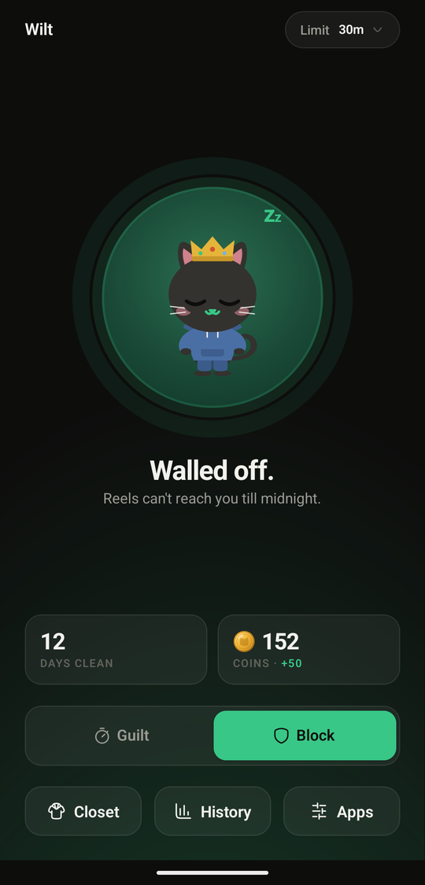
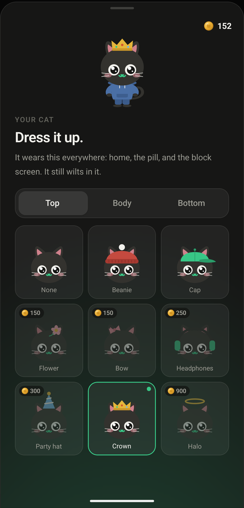
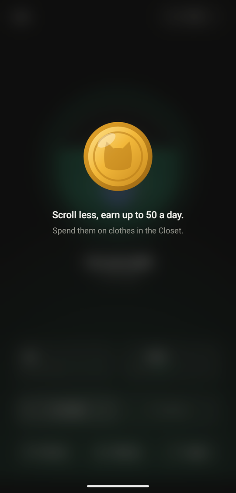
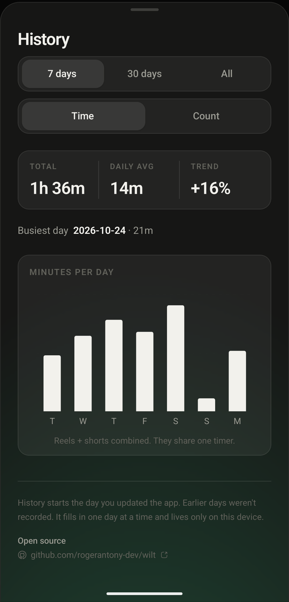
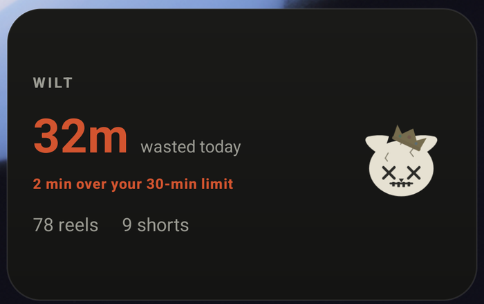
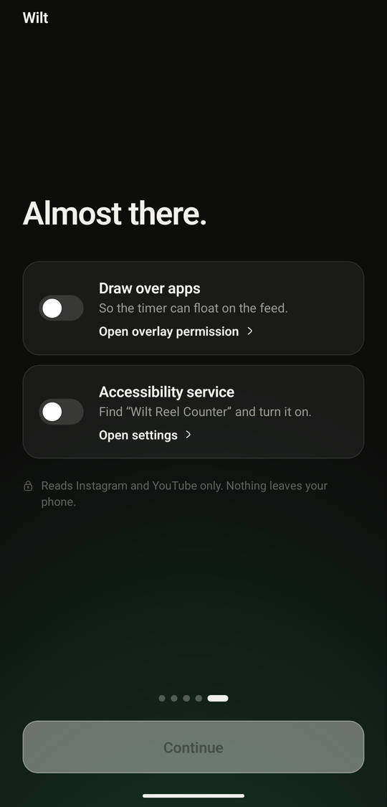

<p align="center">
  
</p>

<h1 align="center">Wilt</h1>

<p align="center">
  <b>A screen-time app for the only part of your phone that actually eats hours:<br>Instagram Reels and YouTube Shorts.</b>
</p>

<p align="center">
  <a href="https://github.com/rogerantony-dev/wilt/releases/latest"></a>
  <a href="LICENSE"></a>
</p>

<p align="center">
  
  
  
</p>

It times how long you spend in those two feeds, shows the number *while you are in them*, and blocks the feeds once you pass a daily limit you set. Android only. No account, and nothing leaves your device.

## What it is

Your phone's built-in screen-time report tells you what you did yesterday. That is too late to act on, and it measures the wrong thing: "3 hours on Instagram" cannot tell the difference between messaging a friend and thumbing through Reels at 1am.

Wilt measures only the short-form feeds. It keeps a live timer on screen while you scroll, interrupts you when you are spiraling, and takes the feeds away entirely once you have spent your daily allowance. Every day pays coins, more the less you scroll, and coins buy clothes for the cat, so there is something on the other side of stopping.

## Two modes

**Guilt** counts. A floating timer runs while you scroll and the clock reddens as your budget drains. The feeds keep working right up to your daily limit, then get blocked for the rest of the day, with at most three one-minute reprieves.

**Block** refuses outright. Every reel and short is walled off from the moment you open the app, all day. Leaving Block mode makes you confirm it in writing.

<p></p>

Lowering your limit takes effect instantly. Raising it waits until tomorrow's reset, so you cannot talk your way out of a block mid-scroll.

## While you are scrolling

A floating pill sits over the feed with the time so far, and a cat that looks progressively worse as the budget drains.

<p></p>

Separately, a card interrupts when the timing is bad rather than when the budget is gone. There are nudges for the late-night scroll, the first-thing-in-the-morning scroll, the mid-workday scroll, every three minutes of continuous reel time, and the moment you pass yesterday's total.

<p></p>

"Keep scrolling" is a real button. A wall you can never pass just gets uninstalled.

## When it blocks

The inline feed reels get blanked and replaced with the cat, wilted as far as your day has gone and wearing whatever you dressed it in. The overlay eats touches, so scrolling through it does nothing. The line on the cover changes each time the block reappears.

## Coins and the Closet

Each finished day pays up to 50 coins, on minutes alone: 50 for a day with no scrolling, a little over one fewer per minute after that, and nothing from 45 minutes on. Your limit plays no part, so a 5-minute limit earns the same as a 60-minute one for the same restraint. Today's coins show on the home tile as `+N` and shrink as you scroll; they bank at midnight. A day Wilt was switched off pays nothing.

Spend them in the Closet on clothes for the cat: something for its head, its body and its legs. A few pieces are free, the rest cost from 100 to 900 coins, and spent coins stay spent. The cat wears its outfit everywhere it appears: home, the pill, the block screen and the nudge. It still wilts in it.

<p>
  
  
</p>

## History and widget

Seven days, thirty, or everything, by time or by count. History starts the day you install, fills in one day at a time, and never leaves the device. The widget carries the same number to your home screen.

<p>
  
  
</p>

## How it works

The Accessibility API is the only mechanism on Android that can tell an app a Reels or Shorts player is on screen inside another app. Usage-stats APIs report only which app is in the foreground, which cannot separate watching Reels from reading DMs.

The service is scoped in its configuration to exactly two packages, `com.instagram.android` and `com.google.android.youtube`. It reads the view tree in the moment to answer one question, "is a short-form player on screen right now", increments a timer, and at the limit navigates away from the feed. Screen content is evaluated and discarded.

Nothing is recorded, logged, or transmitted. **There is no code anywhere in the app that makes a network request**, in JS or in the native service. (`INTERNET` does appear in the merged manifest, because React Native's template declares it, not because anything uses it.) Everything, history included, lives in a single `SharedPreferences` file on the device.

So it needs two permissions, both explained before either is requested:

<p></p>

## Install

Download the APK from [the latest release](https://github.com/rogerantony-dev/wilt/releases/latest).

**arm64 only**, which covers any phone from roughly 2017 onward. Older 32-bit devices will refuse to install it. Release APKs are signed with a development key rather than a Play Store key, so if you later move to a Play build you will need to uninstall first.

---

## Local setup

### Prerequisites

| | |
|---|---|
| Node | 20 or newer |
| JDK | 21 (`java -version`) |
| Android SDK | platform-tools on `PATH`, `ANDROID_HOME` set |
| Device | a **physical** Android phone with Instagram or YouTube installed |

A physical device matters. The whole app keys off two real packages and needs an accessibility service plus an overlay permission, none of which is meaningful on a bare emulator.

### Get it running

```bash
git clone https://github.com/rogerantony-dev/wilt.git
cd wilt
npm install
npx expo prebuild --platform android    # generates android/ from app.json + plugin/
npx expo run:android                    # debug build, installs, starts Metro
```

`npx expo run:android` produces a dev-client build that loads JS from Metro, so you get fast refresh on everything in `App.tsx` and `components/`.

Then enable both permissions on the device, which the app's onboarding walks you through:

1. **Draw over other apps** → allow for Wilt.
2. **Settings → Accessibility → Wilt Reel Counter** → on.

Open Instagram Reels and the pill should appear within a second or two.

### Release build

This is what the GitHub releases ship: a standalone APK with the JS bundled in, no Metro. When `~/.wilt/upload.keystore` and `~/.wilt/upload.password` exist (the Play upload key, see `docs/play-listing.md`), `plugin/withReleaseSigning.js` signs the release build with that key, which is registered for Android developer verification; otherwise it falls back to the debug key, which is fine for your own device.

```bash
npx expo prebuild --platform android
cd android
./gradlew assembleRelease -PreactNativeArchitectures=arm64-v8a
adb install -r app/build/outputs/apk/release/app-release.apk
```

Drop the `-PreactNativeArchitectures` flag to build all four ABIs, which roughly doubles the APK size.

### Tests

```bash
npm test
```

Jest covers the pure logic, which is deliberately kept free of React and native calls: coins and streaks (`components/progress.ts`), the Closet's catalogue and prices (`closet.ts`), the cat's figure geometry (`catshapes.ts`), history bucketing (`history.ts`), nudge selection (`nudges.ts`), and the clock's transform matrices (`catmatrix.ts`).

### Changing the native side

`android/` is **generated and gitignored**. Editing it directly works until the next prebuild silently overwrites your changes. The real sources are:

| Path | What it is |
|---|---|
| `plugin/native/ReelAccessibilityService.kt` | Detection, timing, blocking, the pill, the cover, the nudges |
| `plugin/native/WiltWidgetProvider.kt` | The home-screen widget |
| `plugin/native/res/` | Widget layouts, the dressed cat's PNG layers (`drawable-nodpi/`) |
| `plugin/withReelCounter.js` | Config plugin that copies all of the above into `android/` at prebuild, and patches the manifest |
| `modules/wiltnative/` | Expo module exposing the service's state to JS |

Edit those, re-run `npx expo prebuild --platform android`, rebuild.

To add a Closet item: add it to `ITEMS` in `components/closet.ts` and, with the same id and price, to `PRICES` in `modules/wiltnative/android/src/main/java/expo/modules/wiltnative/Closet.kt`. Draw it in `design-previews/cat-figure.js`, port the drawing to `components/catshapes.ts`, add its id to the slot's list in `scripts/render-cat-layers.sh`, and run `bash scripts/render-cat-layers.sh` to render the layers the service draws.

### Gotchas

- **`adb shell am force-stop` kills the accessibility service**, and Android leaves it switched off. The app then drops back to onboarding until you re-enable it in Settings. Use `adb shell input keyevent KEYCODE_HOME` instead when you just want the app backgrounded.
- **Payment apps switch the service off.** Paytm and similar UPI/banking apps refuse to pay while any third-party accessibility service is enabled, and it is the enabled state they check, not overlays. So when a payment app comes to the front, the service calls `disableSelf()`, posts a notification, and the app shows a resume screen that deep-links to the Settings entry. Wilt finds payment apps on the phone itself: apps that take `upi://pay` links, apps whose name says bank, UPI, pay or wallet, and the short `known` list in `plugin/native/PaymentPause.kt`. Android gives an app no way to re-enable its own service, unless you grant it secure-settings access over adb. After that, Wilt turns itself back on when you open it, a few minutes after each pause (checking every 30 seconds until you have left the payment app), and after a reboot or an update. Grant Usage access as well and it comes back the moment you leave the payment app:

  ```bash
  adb shell pm grant com.rogerantony.wilt android.permission.WRITE_SECURE_SETTINGS
  adb shell appops set com.rogerantony.wilt SCHEDULE_EXACT_ALARM allow
  adb shell appops set com.rogerantony.wilt GET_USAGE_STATS allow
  ```

  The second line is optional. Without it the resume alarm is inexact, and Battery Saver stretches it (an inexact 4-minute alarm fired after 11 on a Galaxy A54).
- **Raising the daily limit does nothing today.** It is deferred to the next daily reset on purpose. Lowering it is instant.
- **`expo prebuild` rewrites `android/gradle.properties`**, so pin the ABI with the `-P` flag on the Gradle command rather than editing that file.
- The daily counters roll over at local midnight, when the service next sees a new date.

## Privacy

No analytics, no crash reporting, no network calls, no account. The [privacy policy](docs/privacy-policy.md) is the long version of that sentence.

## License

MIT.
